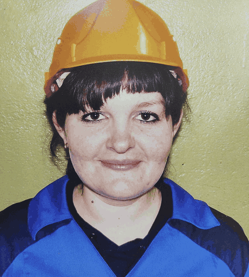

# Оживлённое фото

Мягкая лицевая анимация поверх исходного портрета: дыхание, моргание, движение
взгляда, микро-улыбка и едва заметное покачивание головы. Черты лица не
генерируются заново — используется деформационное поле (warp) по фотографии.



## Файлы

| Файл | Что это | Размер |
|---|---|---|
| [`photo_alive.mp4`](photo_alive.mp4) | видео 1080×1440, 24 к/с, 6 с, бесшовный цикл | 5,9 МБ |
| [`photo_alive.gif`](photo_alive.gif) | GIF-превью 420 px для мессенджеров и сторис | 2,0 МБ |
| [`original.jpg`](original.jpg) | исходная фотография, без изменений | 4,8 МБ |
| [`animate.py`](animate.py) | скрипт, которым собрана анимация | 9 КБ |

## Как скачать

- Откройте файл, например [`photo_alive.mp4`](photo_alive.mp4), и нажмите
  **«Download raw file»** (иконка ↓ в правом верхнем углу просмотра).
- Либо прямая ссылка:
  `https://github.com/serdub2-bot/gdp-dashboard/raw/arena/38de8519-gdp-dashboard/media/zhivoe-foto/photo_alive.mp4`

## Как перегенерировать

```bash
pip install pillow numpy scipy imageio-ffmpeg
python animate.py
```

Скрипт читает `original.jpg` и пишет `photo_alive.mp4` (нужен `ffmpeg` —
`imageio-ffmpeg` скачивает его сам). Все параметры движения — амплитуды дыхания,
моргания, взгляда и улыбки — вынесены в начало файла.
